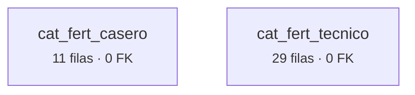
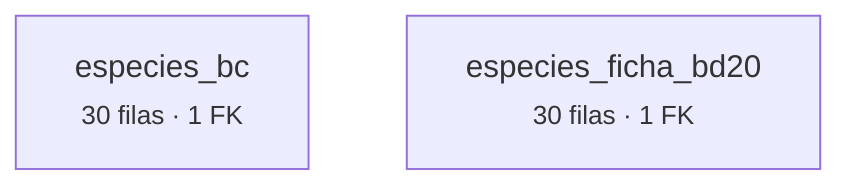
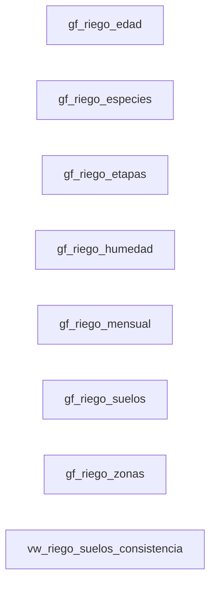

# Base de datos — mapa y relaciones

> Generado con `scripts/generar_diagrama_base.mjs` leyendo el esquema real.
>
> **48 tablas · 8 vistas · 6.826 filas · 46 claves foráneas · 4 enums**

## Cómo leer esto

La normalización dejó la base separada en familias, con una regla:

- **`dim_*`** — las cosas que *son*: el frutal, la comuna, la zona, el mes. Se escriben
  **una sola vez**.
- **`fact_*`** — las cosas que *pasan*: cuánto riego, qué tarea, en qué mes. Se apuntan
  a las dimensiones, no las repiten.
- **`gf_*` y `perfiles`** — lo que es de cada usuario. Nada de esto viene del Excel.

Lo que se ganó: el nombre de un frutal está escrito **una vez**, en `dim_especies`.
Antes estaba repetido en 34 archivos.

---

## 1. La base por familias

### dim_* — las dimensiones: el 'qué' y el 'dónde'

```mermaid
graph TD
  dim_comunas["dim_comunas<br/><small>346 filas · 3 FK</small>"]
  dim_edad["dim_edad<br/><small>4 filas · 0 FK</small>"]
  dim_edad_nutricion["dim_edad_nutricion<br/><small>3 filas · 0 FK</small>"]
  dim_especies["dim_especies<br/><small>30 filas · 0 FK</small>"]
  dim_etapas["dim_etapas<br/><small>8 filas · 0 FK</small>"]
  dim_humedad["dim_humedad<br/><small>5 filas · 0 FK</small>"]
  dim_macrozonas["dim_macrozonas<br/><small>6 filas · 0 FK</small>"]
  dim_meses["dim_meses<br/><small>12 filas · 0 FK</small>"]
  dim_parcializacion["dim_parcializacion<br/><small>20 filas · 0 FK</small>"]
  dim_suelos["dim_suelos<br/><small>4 filas · 0 FK</small>"]
  dim_zonas_agro["dim_zonas_agro<br/><small>20 filas · 0 FK</small>"]
  dim_zonas_riego["dim_zonas_riego<br/><small>11 filas · 0 FK</small>"]
```



### fact_* — los hechos: el 'cuándo' y el 'cuánto'

```mermaid
graph TD
  fact_clima_zona["fact_clima_zona<br/><small>20 filas · 1 FK</small>"]
  fact_consejos["fact_consejos<br/><small>211 filas · 1 FK</small>"]
  fact_fenologia["fact_fenologia<br/><small>180 filas · 2 FK</small>"]
  fact_fert_organica["fact_fert_organica<br/><small>181 filas · 1 FK</small>"]
  fact_fert_programa["fact_fert_programa<br/><small>786 filas · 2 FK</small>"]
  fact_ficha_fertilizacion["fact_ficha_fertilizacion<br/><small>149 filas · 1 FK</small>"]
  fact_ficha_riego["fact_ficha_riego<br/><small>149 filas · 1 FK</small>"]
  fact_labores_mes["fact_labores_mes<br/><small>360 filas · 2 FK</small>"]
  fact_manejo_estacion["fact_manejo_estacion<br/><small>120 filas · 1 FK</small>"]
  fact_nutrientes_anual["fact_nutrientes_anual<br/><small>30 filas · 1 FK</small>"]
  fact_plagas["fact_plagas<br/><small>110 filas · 1 FK</small>"]
  fact_poda["fact_poda<br/><small>104 filas · 1 FK</small>"]
  fact_riego_etapa["fact_riego_etapa<br/><small>210 filas · 2 FK</small>"]
  fact_riego_mes["fact_riego_mes<br/><small>360 filas · 2 FK</small>"]
  fact_sanidad["fact_sanidad<br/><small>160 filas · 1 FK</small>"]
  fact_sugerencias["fact_sugerencias<br/><small>335 filas · 1 FK</small>"]
  fact_tareas_mes["fact_tareas_mes<br/><small>240 filas · 2 FK</small>"]
  fact_viabilidad_zona["fact_viabilidad_zona<br/><small>600 filas · 2 FK</small>"]
```



### gf_* y perfiles — lo que es de cada usuario

```mermaid
graph TD
  gf_analytics_events["gf_analytics_events<br/><small>1694 filas · 1 FK</small>"]
  gf_aplicaciones["gf_aplicaciones<br/><small>3 filas · 3 FK</small>"]
  gf_arboles["gf_arboles<br/><small>150 filas · 3 FK</small>"]
  gf_cron_config["gf_cron_config<br/><small>1 filas · 0 FK</small>"]
  gf_cultivos["gf_cultivos<br/><small>3 filas · 1 FK</small>"]
  gf_huertos["gf_huertos<br/><small>22 filas · 1 FK</small>"]
  gf_registro["gf_registro<br/><small>1 filas · 1 FK</small>"]
  gf_sponsorships["gf_sponsorships<br/><small>1 filas · 0 FK</small>"]
  gf_subscription_plans["gf_subscription_plans<br/><small>6 filas · 0 FK</small>"]
  gf_subscriptions["gf_subscriptions<br/><small>13 filas · 1 FK</small>"]
  gf_tareas["gf_tareas<br/><small>10 filas · 1 FK</small>"]
  gf_user_audiences["gf_user_audiences<br/><small>2 filas · 1 FK</small>"]
  gf_user_consents["gf_user_consents<br/><small>40 filas · 1 FK</small>"]
  perfiles["perfiles<br/><small>6 filas · 1 FK</small>"]
```



### cat_* — catálogos de productos



### especies_* — ficha amplia por especie




## 2. El núcleo agronómico, con sus relaciones


```mermaid
erDiagram
dim_comunas {
  text comuna_id PK
  text macrozona_id
  text zona_riego_id
  text zona_agro_id
  int filas 346
}
dim_edad {
  text edad_n PK
  int filas 4
}
dim_edad_nutricion {
  text edad_nutricion_id PK
  int filas 3
}
dim_especies {
  text especie_id PK
  int filas 30
}
dim_etapas {
  text codigo_etapa PK
  int filas 8
}
dim_humedad {
  text humedad_n PK
  int filas 5
}
dim_macrozonas {
  text macrozona_id PK
  int filas 6
}
dim_meses {
  text mes_n PK
  int filas 12
}
dim_parcializacion {
  text clave PK
  int filas 20
}
dim_suelos {
  text suelo_id PK
  int filas 4
}
dim_zonas_agro {
  text zona_agro_id PK
  int filas 20
}
dim_zonas_riego {
  text zona_riego_id PK
  int filas 11
}
fact_clima_zona {
  text zona_agro_id PK
  int filas 20
}
fact_consejos {
  text especie_id PK
  text n PK
  int filas 211
}
fact_fenologia {
  text clave PK
  text especie_id
  text macrozona_id
  int filas 180
}
fact_fert_organica {
  text especie_id PK
  text n PK
  text mes PK
  int filas 181
}
fact_fert_programa {
  text clave PK
  text macrozona_id
  text especie_id
  int filas 786
}
fact_ficha_fertilizacion {
  text especie_id PK
  text n PK
  int filas 149
}
fact_ficha_riego {
  text especie_id PK
  text n PK
  int filas 149
}
fact_labores_mes {
  text clave PK
  text mes_n
  text especie_id
  int filas 360
}
fact_manejo_estacion {
  text especie_id PK
  text estacion PK
  int filas 120
}
fact_nutrientes_anual {
  text especie_id PK
  int filas 30
}
fact_plagas {
  text especie_id PK
  text plaga_enfermedad PK
  int filas 110
}
fact_poda {
  text especie_id PK
  text n PK
  int filas 104
}
fact_riego_etapa {
  text clave PK
  text codigo_etapa
  text especie_id
  int filas 210
}
fact_riego_mes {
  text clave PK
  text especie_id
  text mes_n
  int filas 360
}
fact_sanidad {
  text especie_id PK
  text n PK
  int filas 160
}
fact_sugerencias {
  text especie_id PK
  text tipo PK
  text nombre PK
  int filas 335
}
fact_tareas_mes {
  text clave PK
  text especie_id
  text mes_n
  int filas 240
}
fact_viabilidad_zona {
  text clave PK
  text especie_id
  text zona_agro_id
  int filas 600
}
  dim_comunas macrozona_id --> dim_macrozonas
  dim_comunas zona_riego_id --> dim_zonas_riego
  dim_comunas zona_agro_id --> dim_zonas_agro
  fact_clima_zona zona_agro_id --> dim_zonas_agro
  fact_consejos especie_id --> dim_especies
  fact_fenologia especie_id --> dim_especies
  fact_fenologia macrozona_id --> dim_macrozonas
  fact_fert_organica especie_id --> dim_especies
  fact_fert_programa macrozona_id --> dim_macrozonas
  fact_fert_programa especie_id --> dim_especies
  fact_ficha_fertilizacion especie_id --> dim_especies
  fact_ficha_riego especie_id --> dim_especies
  fact_labores_mes mes_n --> dim_meses
  fact_labores_mes especie_id --> dim_especies
  fact_manejo_estacion especie_id --> dim_especies
  fact_nutrientes_anual especie_id --> dim_especies
  fact_plagas especie_id --> dim_especies
  fact_poda especie_id --> dim_especies
  fact_riego_etapa codigo_etapa --> dim_etapas
  fact_riego_etapa especie_id --> dim_especies
  fact_riego_mes especie_id --> dim_especies
  fact_riego_mes mes_n --> dim_meses
  fact_sanidad especie_id --> dim_especies
  fact_sugerencias especie_id --> dim_especies
  fact_tareas_mes especie_id --> dim_especies
  fact_tareas_mes mes_n --> dim_meses
  fact_viabilidad_zona especie_id --> dim_especies
  fact_viabilidad_zona zona_agro_id --> dim_zonas_agro
```

## 3. Lo del usuario y la telemetría


```mermaid
erDiagram
gf_analytics_events {
  text id PK
  text user_id
  int filas 1694
}
gf_aplicaciones {
  text id PK
  text user_id
  text arbol_id
  text territorio_huerto_id
  int filas 3
}
gf_arboles {
  text id PK
  text user_id
  text edad_n
  text huerto_id
  int filas 150
}
gf_cron_config {
  text id PK
  int filas 1
}
gf_cultivos {
  text id PK
  text user_id
  int filas 3
}
gf_huertos {
  text id PK
  text user_id
  int filas 22
}
gf_registro {
  text id PK
  text user_id
  int filas 1
}
gf_sponsorships {
  text id PK
  int filas 1
}
gf_subscription_plans {
  text id PK
  int filas 6
}
gf_subscriptions {
  text id PK
  text user_id
  int filas 13
}
gf_tareas {
  text id PK
  text user_id
  int filas 10
}
gf_user_audiences {
  text id PK
  text user_id
  int filas 2
}
gf_user_consents {
  text id PK
  text user_id
  int filas 40
}
perfiles {
  text id PK
  int filas 6
}
  gf_aplicaciones arbol_id --> gf_arboles
  gf_aplicaciones territorio_huerto_id --> gf_huertos
  gf_arboles huerto_id --> gf_huertos
  gf_user_audiences user_id --> perfiles
```

## 4. Las 8 vistas

No son tablas ni guardan datos: son ventanas que **muestran información ya calculada**
a partir de las tablas de arriba. Existen justamente para no duplicar nada.



## 5. Las listas de valores válidos (enums)

Antes se podía escribir cualquier texto donde estos campos. Ahora hay una lista
cerrada, y la base **rechaza** lo que no esté en ella.

**`sponsorship_payment_status`** — `unpaid` · `pending` · `paid` · `failed`

**`sponsorship_screen`** — `explorar` · `huerto` · `ficha` · `calendario`

**`telem_event_category`** — `PRODUCT_USAGE` · `AD_INTERACTION` · `CMP_CONSENT` · `COMMERCE_INTENT`

**`telem_event_name`** — `VIEW_FICHA` · `PAGE_VIEW` · `CALCULATOR_SUBMIT` · `AD_IMPRESSION` · `AD_CLICK` · `SEARCH_INP` · `CMP_CONSENT_GRANTED` · `CMP_CONSENT_UPDATED` · `INPUT_QUOTE`

---

*Generado el 2026-10-12 · se regenera con `node scripts/generar_diagrama_base.mjs`*
